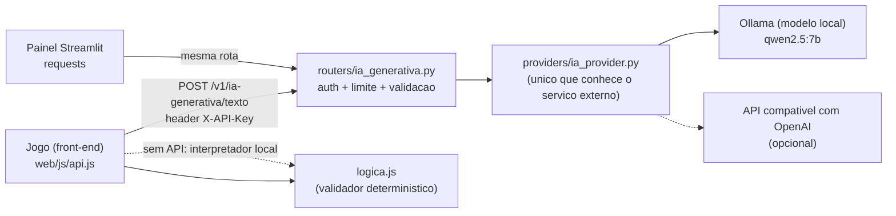
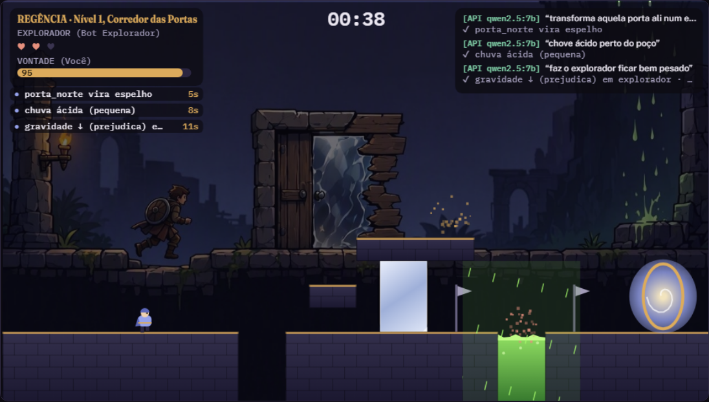
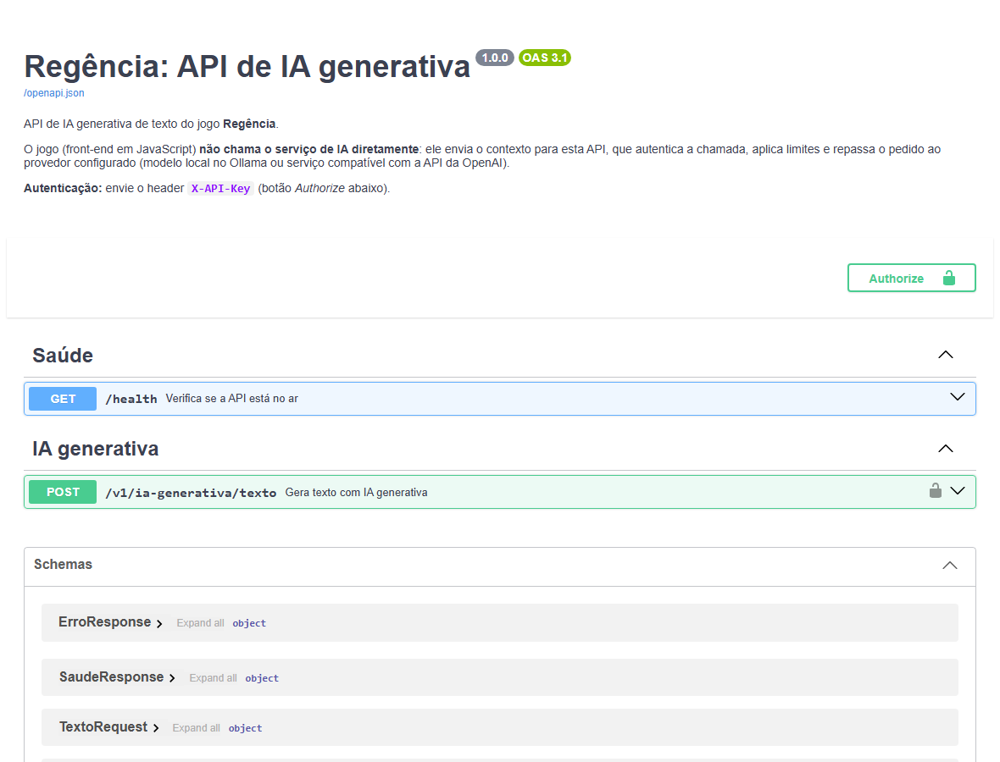
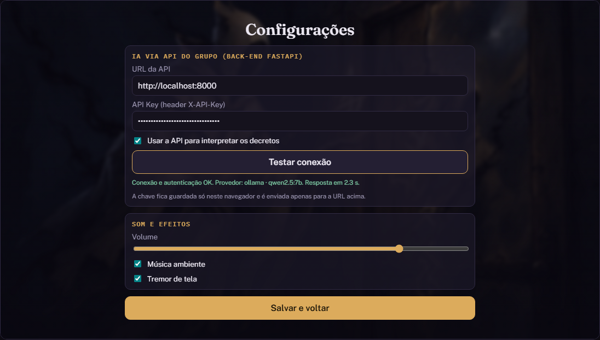
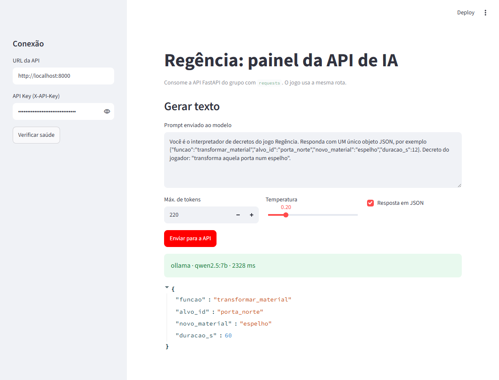
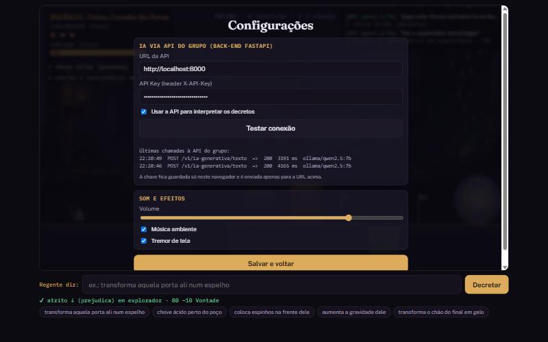
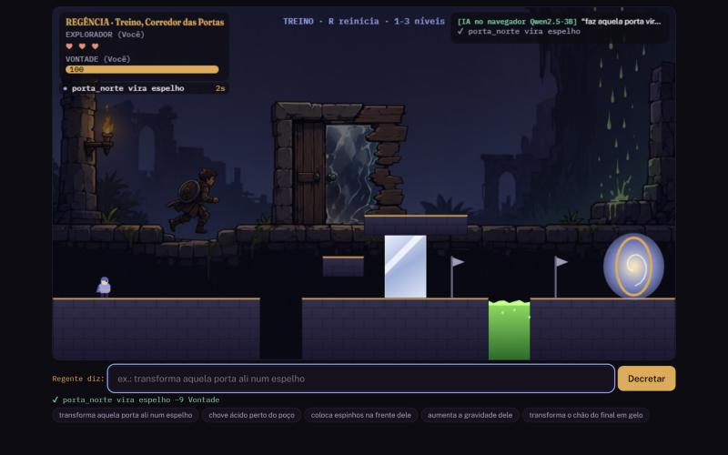

[](https://arthur-baptista-dos-santos.github.io/REGENCIA/)
[](https://github.com/Arthur-Baptista-dos-Santos/REGENCIA/actions/workflows/pages.yml)
[](https://youtu.be/s1Bj-OcbRlQ)

# `Regencia: Jogo Cooperativo com IA Generativa`

> Coop assimetrico de plataforma em que o Regente dita decretos em portugues e uma IA generativa os transforma em efeitos de jogo, sob um validador deterministico que garante que o nivel continua vencivel. O jogo (front-end em JavaScript) nao chama o servico de IA diretamente: ele consome uma **API FastAPI propria do grupo**, com rota, provider, autenticacao por `X-API-Key`, CORS e Swagger. Checkpoint 5 de Processamento de Linguagem Natural e do Front-end, FIAP.

---

## `Integrantes`

| Nome | RM |
|---|---|
| Arthur Baptista dos Santos | 565346 |
| João Pedro de Moura Dutra Franco | 561738 |
| Nelson Félix Neto | 565603 |

Inteligencia Artificial · FIAP 2025-2026

---

## `Tecnologias`


---

## `Visao geral`

O repositorio tem **projetos separados**, cada um com seu README, dependencias e testes:

| Pasta | O que e | Stack |
|---|---|---|
| [`web/`](web) | **Front-end**: o jogo jogavel no navegador | JavaScript puro, HTML5 Canvas, PWA |
| [`backend/`](backend) | **API de IA generativa**: rota, provider, autenticacao, CORS, Swagger | FastAPI, Pydantic, httpx |
| [`painel/`](painel) | Painel que consome a mesma API com `requests` | Streamlit, requests |
| [`prototipo_python/`](prototipo_python) | Prototipo da CP4 (interpretador e validador em Python) | Python, pydantic, Pygame |
| [`docs/`](docs) | Arquitetura, produto e evidencias | Markdown e capturas |
| [`ENTREGA_FRONTEND/`](ENTREGA_FRONTEND) | **Entregaveis da disciplina de Front-end** (mapa requisito a requisito, trechos de codigo, evidencias, dados do grupo) | Markdown e capturas |

O jogo e **jogavel sem back-end** (um interpretador local por palavras-chave assume). Com o back-end ligado, os decretos do jogador sao interpretados por um modelo de linguagem de verdade.

---

## `Arquitetura`



Padrao **rota -> provider**: o router (`backend/app/routers/ia_generativa.py`) cuida de HTTP, autenticacao e erros; o provider (`backend/app/providers/ia_provider.py`) e a unica camada que fala com o servico de IA. Trocar de Ollama para outro servico e mudar uma variavel de ambiente.

Cadeia de decisao no jogo, para nunca travar: **API do grupo -> modelo no navegador (Qwen2.5-3B via WebGPU) -> IA do ambiente -> interpretador local**. Em qualquer caso a resposta da IA e tratada como dado nao confiavel: so vira efeito se estiver no catalogo e passar pelo validador deterministico. Detalhes em [docs/ARQUITETURA.md](docs/ARQUITETURA.md).

---

## `Jogar na web, sem instalar nada (IA no navegador)`

O site publicado nao precisa de back-end: no menu, **Ativar IA no navegador** baixa uma vez o modelo Qwen2.5-3B (cerca de 2,5 GB, fica em cache) e ele roda 100% na sua GPU via WebGPU (Chrome ou Edge no computador). A saida do modelo e restrita por **gramatica JSON** (so funcoes do catalogo e so ids de objetos que existem no nivel), o que elimina alvos inventados. Sem WebGPU, ou sem ativar, o interpretador local por palavras-chave mantem o jogo jogavel.

A qualidade foi **medida** (nao suposta) com o prompt e o validador reais do jogo, em 40 frases, 20 delas parafrases que o interpretador local nao conhece. Resumo das parafrases:

| Interpretador | Funcao correta | Parametros corretos | Latencia mediana |
|---|---|---|---|
| Qwen2.5-3B no navegador (prompt curto + gramatica) | 95% | 80% | 15,5 s (GPU integrada Intel) |
| Qwen2.5-1.5B no navegador (prompt curto + gramatica) | 70% | 75% | 9,1 s |
| Interpretador local (palavras-chave) | 80% | 65% | instantaneo |

Tabela completa, metodo e como reproduzir em [docs/evidencias/benchmark_webllm.md](docs/evidencias/benchmark_webllm.md). **Aviso de hardware:** em GPU integrada o modelo de 3B e lento (cerca de 15 s por decreto) e, nos testes, a GPU integrada Intel chegou a reiniciar o driver e, uma vez, o computador. Para jogar com IA prefira GPU dedicada ou use a API do grupo (3 a 4 s); o jogo detecta a GPU reiniciada e volta para o interpretador local. O prompt original (longo) foi abandonado para o navegador: errava o alvo e chegou a derrubar o driver da GPU integrada; o prompt curto com gramatica resolveu os dois problemas.

---

## `O que instalar`

| Ferramenta | Para que | Obrigatorio |
|---|---|---|
| Python 3.11 ou mais novo | back-end e painel | sim, para rodar a API |
| [Ollama](https://ollama.com/) + modelo `qwen2.5:7b` | IA generativa local, sem chave e sem custo | sim, para a IA real (ou use outro provedor, veja abaixo) |
| Navegador moderno (Chrome, Edge, Firefox) | jogar | sim |
| Node.js 20+ | so para rodar os testes do jogo | nao |
| Docker | alternativa para subir a API em contêiner | nao |

```bash
ollama pull qwen2.5:7b      # cerca de 4,7 GB, uma vez
```

Sem Ollama? Use `PROVEDOR=openai` com qualquer API compativel (veja [backend/README.md](backend/README.md)) ou `PROVEDOR=simulado` (sem IA, so para testar a API).

---

## `Como rodar`

**1. Back-end (API)**

```bash
git clone https://github.com/Arthur-Baptista-dos-Santos/REGENCIA.git
cd REGENCIA/backend

python -m venv .venv
.venv\Scripts\activate       # Windows
# source .venv/bin/activate  # Linux/Mac
pip install -r requirements.txt

cp .env.example .env         # depois edite o .env e defina API_KEY
python -c "import secrets; print(secrets.token_urlsafe(32))"   # gera uma chave para colar em API_KEY

uvicorn app.main:app --port 8000
```

Abra **http://localhost:8000/docs** (Swagger). Clique em *Authorize*, cole a `API_KEY` e teste a rota.

**2. Jogo (front-end)**

```bash
cd REGENCIA/web
python -m http.server 8080   # abrir http://localhost:8080
```

No menu, abra **Configuracoes**, informe `http://localhost:8000` e a mesma `API_KEY`, marque *Usar a API* e clique em **Testar conexao**. Pronto: os decretos passam pela API (o log do jogo mostra o selo `API qwen2.5:7b`).

Tambem funciona no site publicado: https://arthur-baptista-dos-santos.github.io/REGENCIA/ (o navegador permite chamar `http://localhost:8000` e o CORS ja autoriza essa origem).

**3. Painel (opcional)**

```bash
cd REGENCIA/painel
python -m venv .venv && .venv\Scripts\activate
pip install -r requirements.txt
streamlit run app.py         # http://localhost:8501
```

**4. Docker (opcional)**

```bash
cp backend/.env.example backend/.env    # defina API_KEY
docker compose up --build               # API em http://localhost:8000
```

---

## `API`

| Metodo | Rota | Auth | Descricao |
|---|---|---|---|
| GET | `/health` | nao | Estado da API, provedor e modelo (sem dados sensiveis) |
| POST | `/v1/ia-generativa/texto` | `X-API-Key` | Recebe o contexto do jogo e devolve o texto gerado |
| GET | `/docs` e `/redoc` | nao | Documentacao automatica (Swagger e ReDoc) |

```bash
curl -X POST http://localhost:8000/v1/ia-generativa/texto \
  -H "X-API-Key: $API_KEY" -H "Content-Type: application/json" \
  -d '{"prompt": "Responda apenas com JSON: transforma aquela porta num espelho", "max_tokens": 220, "temperatura": 0.2, "formato_json": true}'
```

```json
{"texto": "{\"funcao\":\"transformar_material\",\"alvo_id\":\"porta_norte\",\"novo_material\":\"espelho\",\"duracao_s\":15}",
 "provedor": "ollama", "modelo": "qwen2.5:7b", "latencia_ms": 3937}
```

| Status | Quando |
|---|---|
| 200 | Texto gerado |
| 401 | `X-API-Key` ausente ou errada |
| 422 | Prompt vazio, grande demais ou parametros fora da faixa |
| 429 | Mais de 30 requisicoes por minuto por chave e IP (configuravel) |
| 502, 503, 504 | O servico de IA respondeu com erro, esta fora do ar ou demorou demais |

Autenticacao, CORS (origens permitidas), limites e provedor sao configurados por variaveis de ambiente (`backend/.env.example`). Nenhum segredo fica no codigo.

---

## `Evidencias`

O PDF da disciplina pede a prova de que o jogo usa a API do grupo em tempo de execucao. Tudo abaixo foi gerado com a API rodando e o modelo real:

| Jogo chamando a API | Swagger em `/docs` |
|---|---|
|  |  |

| Configuracoes do jogo (teste de conexao) | Painel Streamlit com `requests` |
|---|---|
|  |  |

- No log do jogo cada decreto traz o selo `API qwen2.5:7b`: significa que a interpretacao veio da rota `POST /v1/ia-generativa/texto`, e nao de uma chamada direta ao servico de IA.
- [docs/evidencias/chamadas_curl.txt](docs/evidencias/chamadas_curl.txt): registro real das chamadas (401 sem chave, 401 chave errada, 422, 200 com o prompt do jogo, preflight CORS).
- Em **Configuracoes** o jogo lista as ultimas chamadas feitas a rota (hora, `POST /v1/ia-generativa/texto`, status HTTP, tempo e modelo), prova visual de que consome a API em tempo de execucao.

| Registro de chamadas na tela de Configuracoes | IA rodando no navegador (sem back-end) |
|---|---|
|  |  |

---

## `Testes`

```bash
node --test tests/logica.test.js tests/api.test.js tests/modelo.test.js     # jogo, cliente da API e prompt do modelo: 43 testes
cd backend && pytest -q                                 # API: 32 testes (auth, providers, CORS, erros, limite)
cd painel && pytest -q                                  # painel: 8 testes
cd prototipo_python && pytest -q                        # prototipo da CP4: 12 testes
```

O CI (GitHub Actions) roda tudo isso, alem de `ruff`, `mypy --strict` no back-end e de construir a imagem Docker e testar `/health`, 401 e 200, antes de publicar o jogo no GitHub Pages.

---

## `Estrutura do repositorio`

```
REGENCIA/
    backend/                    API FastAPI (projeto 1)
        app/
            main.py             cria o app, CORS, routers, Swagger
            config.py           configuracao por variaveis de ambiente
            security.py         X-API-Key e limite de requisicoes
            schemas.py          contratos da API (Pydantic)
            routers/            ia_generativa.py (rota), saude.py
            providers/          ia_provider.py (Ollama, OpenAI compativel, simulado)
        tests/                  32 testes
        Dockerfile  .env.example  requirements.txt
    web/                        jogo, front-end (projeto 2)
        js/logica.js            regras puras, validador, planejador, interpretador local
        js/api.js               cliente da API do grupo
        js/jogo.js              motor, fisica, bot, telas
        sw.js  manifest.webmanifest  icons/  assets/
    painel/                     Streamlit + requests (projeto 3)
    prototipo_python/           prototipo da CP4
    tests/                      testes do jogo (Node)
    docs/                       ARQUITETURA.md, PRODUTO.md, evidencias, capturas
    docker-compose.yml
    .github/workflows/pages.yml CI e deploy
```

---

## `Conceitos aplicados`

- **`Rota -> provider`**: HTTP isolado do servico de IA, trocavel por configuracao
- **`Autenticacao por API Key`**: header `X-API-Key` comparado com `hmac.compare_digest`, sem vazar a chave pelo tempo de resposta
- **`CORS explicito`**: so as origens configuradas (jogo local e GitHub Pages), com suporte ao preflight de rede privada
- **`Limite de requisicoes`**: janela deslizante por chave e IP, depois da autenticacao
- **`Contratos com Pydantic`**: validacao de entrada e documentacao Swagger gerada dos mesmos modelos
- **`Degradacao elegante`**: se a API ou o modelo falham, o jogo cai no interpretador local e segue jogavel
- **`Validador deterministico`**: a garantia de jogabilidade nao depende do modelo
- **`Provider isolado e testavel`**: testes com transporte HTTP simulado, sem rede e sem IA real

---

## `Mais`

- [docs/ARQUITETURA.md](docs/ARQUITETURA.md): fluxo completo, decisoes, limitacoes
- [docs/PRODUTO.md](docs/PRODUTO.md): o jogo como produto (publico, modelo de negocio, roadmap, lancamento)
- [backend/README.md](backend/README.md) e [painel/README.md](painel/README.md): detalhes de cada projeto
- Video do Checkpoint 5 de PLN: https://youtu.be/s1Bj-OcbRlQ

---

## `Licenca`

Distribuido sob a licenca MIT. Veja [LICENSE](LICENSE) para mais informacoes.

---

## `Autor`

**Arthur Baptista dos Santos**
RM 565346 · Inteligencia Artificial · FIAP 2025-2026

[](https://linkedin.com/in/arthur-baptista-dos-santos)
[](https://github.com/Arthur-Baptista-dos-Santos)
