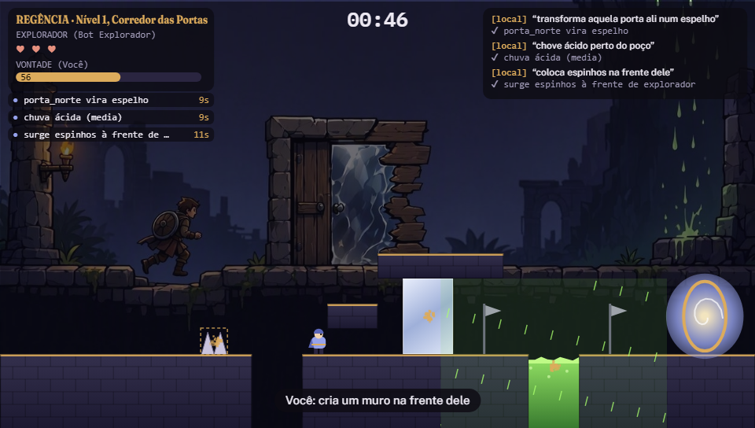
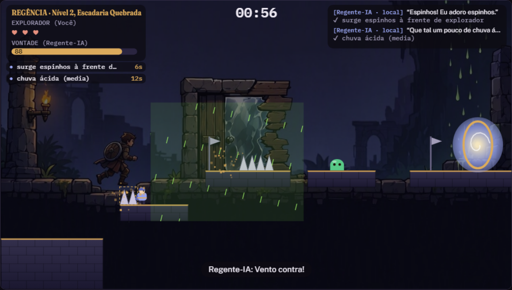
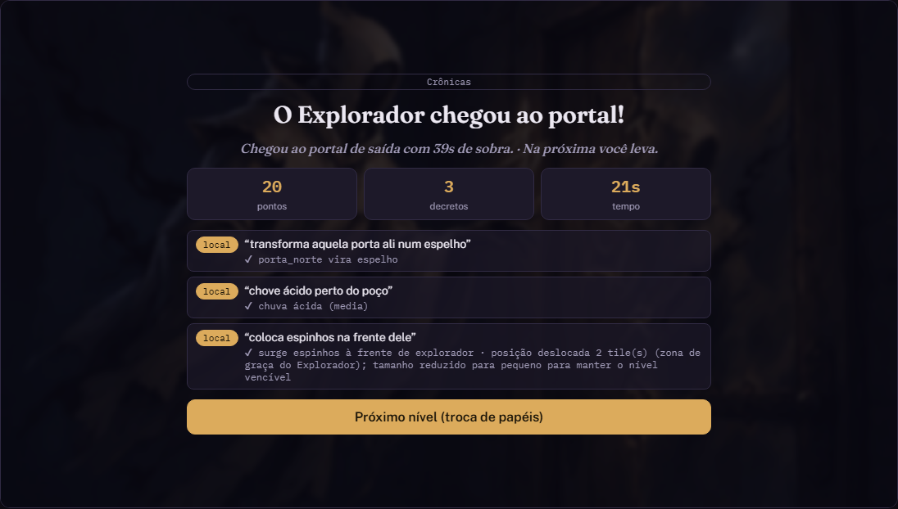

[](https://arthur-baptista-dos-santos.github.io/REGENCIA/)
[](https://github.com/Arthur-Baptista-dos-Santos/REGENCIA/actions/workflows/pages.yml)

# `Regencia: Jogo Cooperativo com IA Generativa`

> Coop assimetrico de plataforma em que o Regente dita decretos em portugues e uma IA generativa os transforma em efeitos de jogo, sob um validador deterministico que garante que o nivel continua vencivel. Jogavel direto no navegador, sem instalar nada. Checkpoint 5 (Vibe Coding e MVP), Processamento de Linguagem Natural, Chatbots e Agentes Virtuais, FIAP.

---

## `Jogar`

**[Clique aqui para jogar](https://arthur-baptista-dos-santos.github.io/REGENCIA/)**: abre direto no navegador (computador, com teclado).

1. Escolha **Treino livre** para testar sem tempo, ou **Campanha solo** para a experiencia completa.
2. Como Regente, digite um decreto do seu jeito, por exemplo `transforma aquela porta ali num espelho` ou `chove acido perto do poco`, e aperte Enter.
3. Como Explorador, use as setas e a seta para cima (pular) para chegar ao portal de saida.

Por padrao os decretos sao interpretados pelo **interpretador local** (palavras-chave e sinonimos), que e so codigo. Para usar **IA generativa de verdade**, clique em **Ativar IA no navegador** no menu: o jogo baixa uma vez (cerca de 1 GB, fica guardado no navegador) o modelo de linguagem Qwen2.5-1.5B-Instruct, que roda 100% no seu computador via WebGPU, sem servidor e sem enviar nada para a internet. Precisa de Chrome ou Edge recentes e de uma GPU compativel. Se o modelo errar (alvo inventado, resposta fora do formato) ou demorar mais de 40 segundos, o jogo usa o interpretador local naquele decreto e continua normalmente.

---

## `Tecnologias`


---

## `O que faz`

O Explorador atravessa um nivel de plataforma em tempo real, com fisica deterministica, ate o portal de saida. O Regente nao controla personagem algum: ele escreve frases em linguagem livre e ambigua, e uma IA as traduz em uma de cinco acoes de jogo (transformar material, clima local, criar obstaculo, efeito generico ou remover objeto). Antes de qualquer efeito chegar ao mundo, um validador sem IA confere se o alvo existe, limita os valores e testa se ainda existe um caminho ate a saida. Pedidos exagerados sao atenuados; o impossivel e recusado com explicacao.

---

## `Telas`

| Menu principal | Gameplay (Regente) |
|---|---|
|  |  |

| Gameplay (Explorador) | Cronicas do nivel |
|---|---|
|  |  |

---

## `Modos de jogo`

| Modo | Descricao |
|---|---|
| **Campanha solo** | 3 niveis com troca de papeis: voce e o Regente contra um bot Explorador, depois o Explorador contra um Regente-IA. |
| **Co-op local** | 2 pessoas no mesmo teclado: uma usa as setas, a outra digita os decretos. Trocam de papel a cada nivel. |
| **Treino livre** | Voce controla o Explorador e digita decretos. Sem tempo e sem derrota. `R` reinicia, `1` `2` `3` trocam de nivel. |

Controles: setas e seta para cima (ou `A` `D` `W`/`Espaco` fora da caixa de texto), `Enter` foca a caixa de decreto, `P` pausa, `M` liga ou desliga o som.

---

## `Arquitetura`

```
Regente digita
    |
    Interpretacao
        IA ao vivo (modelo de linguagem no navegador via WebGPU, resposta em JSON)  ou  interpretador local
    |
    coagirDecreto()     schema, enum e limites do catalogo (5 funcoes)
    |
    validarDecreto()    alvo existe? limites? zona de graca? ainda ha caminho ate a saida?
    |
    Vontade suficiente? -> aplicarDecreto() -> fisica deterministica + feedback
    |
    Log "Cronicas" com a fonte de cada decreto
```

```
REGENCIA/
    web/
        index.html            pagina do jogo (gerada por build.js)
        pagina.html           fragmento da pagina
        js/logica.js          regras puras: niveis, catalogo, validador, planejador, interpretador local
        js/jogo.js            motor: loop, fisica, bot, Regente-IA, canvas, telas
        assets/               arte de fundo gerada por IA
    tests/logica.test.js      23 testes automatizados
    prototipo_python/         prototipo da CP4 (Python + pydantic + Pygame), 12 testes
    docs/                     capturas de tela e documentacao
    .github/workflows/        testes e deploy no GitHub Pages
```

---

## `IA generativa no projeto`

| Modalidade | Onde entra | Detalhe |
|---|---|---|
| Texto | Interpreta os decretos do Regente e joga de Regente-IA | Qwen2.5-1.5B-Instruct (Alibaba) rodando no navegador via WebLLM e WebGPU; fallback local se indisponivel |
| Imagem | Fundos do menu e do gameplay | Bing Image Creator (Microsoft), modelo MAI-Image-2.5-Flash |

Personagens, cenario, efeitos visuais e sons sao procedurais (codigo), nao IA.

---

## `Instalacao`

Nao precisa instalar nada: abra `web/index.html`. Para rodar localmente em servidor e executar os testes:

```bash
git clone https://github.com/Arthur-Baptista-dos-Santos/REGENCIA.git
cd REGENCIA

python -m http.server 8000 --directory web     # abrir http://localhost:8000

node --test tests/logica.test.js                # 23 testes (Node 20+)

cd prototipo_python
python -m venv .venv
.venv\Scripts\activate       # Windows
# source .venv/bin/activate  # Linux/Mac
pip install -e ".[dev]"
pytest                       # 12 testes
```

---

## `Conceitos aplicados`

- **`IA como motor de interacao`**: o texto livre do jogador vira acao de jogo estruturada, em vez de menu fechado
- **`Validador deterministico`**: a garantia de jogabilidade nao depende do modelo; recusa alvos inventados e atenua pedidos exagerados
- **`Planejador de caminho`**: Dijkstra sobre grade com arestas de andar, degrau, queda e salto, usado pelo validador e pelo bot Explorador
- **`Zona de graca`**: regras de justica (nada letal perto do Explorador, chuva acida nunca cobre o ponto de renascimento)
- **`Fallback expressivo`**: texto sem palavra-chave reconhecida vira efeito generico proporcional, nunca um "nao posso"
- **`Passo fixo de 120 Hz`**: fisica estavel e reproduzivel, que tambem permite testar o jogo por simulacao
- **`Seguranca de prompt`**: texto do jogador tratado como dado, limitado a 160 caracteres, e saida da IA aceita so se for JSON dentro do catalogo e aprovada pelo validador

---

## `Licenca`

Distribuido sob a licenca MIT. Veja [LICENSE](LICENSE) para mais informacoes.

---

## `Integrantes`

| Nome | RM |
|---|---|
| Arthur Baptista dos Santos | 565346 |
| João Pedro de Moura Dutra Franco | 561738 |
| Nelson Félix Neto | 565603 |

Inteligencia Artificial · FIAP 2025-2026

---

## `Autor`

**Arthur Baptista dos Santos**
RM 565346 · Inteligencia Artificial · FIAP 2025-2026

[](https://linkedin.com/in/arthur-baptista-dos-santos)
[](https://github.com/Arthur-Baptista-dos-Santos)
